<div dir="rtl" align="center">

# Riyadh Retail Analytics
### ‏تحليل أعمال متكامل لقطاع التجزئة باستخدام Power BI

‏**من أرقام متفرقة إلى رؤية واضحة للأداء وقرارات قابلة للدراسة**

**Power BI • DAX • Power Query • Data Modeling • Business Intelligence • Data Storytelling**

</div>

---

## ‏📌 نبذة عن المشروع | Project Overview

‏**Riyadh Retail Analytics** دراسة حالة تحليلية لأداء **8 فروع تجزئة في الرياض**، تربط بين المبيعات والربحية والعملاء والمخزون والتسويق والمشتريات والمرتجعات والعمليات التشغيلية في تقرير Power BI تفاعلي.

‏لا يقتصر الهدف على عرض رسوم بيانية؛ بل على فهم **ما الذي يحدث في الأعمال، وما العوامل التي تستحق التحقيق، وما القرارات التي يمكن أن تدعمها البيانات**. طُوّر المشروع لإظهار منهجيتي العملية في **تحليل البيانات وذكاء الأعمال (Data Analytics & BI)**، من صياغة المشكلة إلى تقديم الرؤى والتوصيات.

## ‏🎯 المشكلة التجارية | Business Problem

‏عندما تُحلّل الأقسام المختلفة بمعزل عن بعضها، قد يُخفي إجمالي المبيعات تحديات مهمة: منتج يبيع بكثرة لكنه منخفض الهامش، فرع يحتاج متابعة للمخزون، مورد ترتفع طلباته لكن تختلف كميات استلامه، أو فئة عملاء تُظهر مبيعات أعلى فقط لأنها تنفّذ فواتير أكثر.

‏**التحدي:** بناء رؤية موحّدة تسمح للإدارة بمقارنة الأداء بين الفروع والمنتجات والفترات، والانتقال من المؤشرات الإجمالية إلى أسباب الاختلاف وفرص التحسين.

## ‏💼 دوري ومنهجية التحليل | My Role & Approach

‏طوّرت المشروع بوصفه **دراسة حالة فردية في تحليل البيانات وذكاء الأعمال**، وشمل العمل:

‏1. **Business Understanding:** تحويل التحديات التجارية إلى أسئلة قابلة للقياس.
‏2. **Data Understanding:** استكشاف الجداول والمفاتيح وفهم مستوى تفاصيل كل جدول (Data Grain).
‏3. **Data Preparation:** مراجعة أنواع البيانات وجودتها وتجهيزها باستخدام Power Query.
‏4. **Data Modeling:** التعامل مع جداول الحقائق والأبعاد والعلاقات بين المبيعات والمنتجات والفروع والعملاء وغيرها.
‏5. **DAX & KPI Development:** إنشاء مؤشرات لحجم المبيعات والربح والشراء والاستلام والنشاط التشغيلي.
‏6. **Dashboard Development:** تصميم رسوم وفلاتر وتفاعلات، واستخدام Drillthrough وBookmarks وTop N لتسهيل استكشاف النتائج.
‏7. **Insight & Recommendations:** تفسير الأنماط، ومراجعة حدود الاستنتاج، واقتراح خطوات أعمال تستحق المتابعة.

## ‏📊 لمحة عن النتائج | Project Snapshot

|‏ المؤشر |‏ القيمة في بيانات المشروع |
|---|---:|
|‏ عدد الفروع | **8** |
|‏ صافي مبيعات الفواتير المكتملة (دون الضريبة) |‏ **5,342,809.39 ريال** |
|‏ عدد الفواتير المسجلة | **98,910** |
|‏ زيارات المتاجر | **563,441** |
|‏ عمليات الإرجاع المسجلة | **2,357** |

‏> **نطاق النتائج:** هذه أرقام تحليلية لبيانات المشروع، وليست نتائج مالية حققتها لصالح شركة أو دليلًا على أثر تجاري منفّذ. بعض المؤشرات تعتمد على تعريف مختلف للفترة أو حالة الفاتورة؛ لذا تُراجع المقارنات وفق تعريف كل مقياس.

## ‏🔎 أسئلة الأعمال | Business Questions

|‏ المجال |‏ السؤال التحليلي |‏ القيمة للإدارة |
|---|---|---|
| **Sales & Stores** |‏ من أين تأتي المبيعات؟ وكيف تختلف بين الفروع والمنتجات والأشهر؟ |‏ تحديد مناطق التركيز التجاري |
| **Profitability** |‏ هل أعلى المنتجات مبيعًا هي الأعلى ربحية؟ |‏ مراجعة التسعير وتكلفة المنتجات |
| **Customers** |‏ هل اختلاف مبيعات الشرائح ناتج عن تكرار الفواتير أم قيمتها؟ |‏ فهم سلوك الشراء وتحسين الاستهداف |
| **Inventory** |‏ ما المنتجات ذات تغطية المخزون المنخفضة؟ |‏ تحديد أولويات متابعة التوريد |
| **Purchasing** |‏ ما الفرق بين الوحدات المطلوبة والمستلمة؟ وهل يختلف الالتزام بالتسليم بين الموردين؟ |‏ متابعة كفاءة المشتريات |
| **Marketing** |‏ كيف تختلف CTR وCPC بين قنوات التسويق؟ |‏ تقييم كفاءة الإنفاق |
| **Returns** |‏ ما أسباب المرتجعات وأثرها على المبالغ المستردة؟ |‏ تحديد المشكلات المتكررة |
| **Store Operations** |‏ كيف تتوزع الزيارات وتغطية الموظفين والحوادث بين الفروع؟ |‏ متابعة الأداء التشغيلي |

## ‏🖥️ معرض لوحات المعلومات | Dashboard Showcase

<p dir="rtl" align="right">الصور المرقمة 1–15 موجودة في مجلد <code>salses</code> وفق الرابط الظاهر في الصورة، والصورة رقم 16 تبدو في جذر المستودع. يعرضها هذا القسم مباشرة دون إعادة تسميتها أو رفعها. لم أربط أرقام الصور بأسماء صفحات محددة لأن مطابقة كل رقم بصفحته لم تُؤكَّد بعد.</p>

<details open>
<summary>📷 صور تقرير Power BI | Dashboard Screenshots (1–16)</summary>

**الصورة 1 | Screenshot 01**

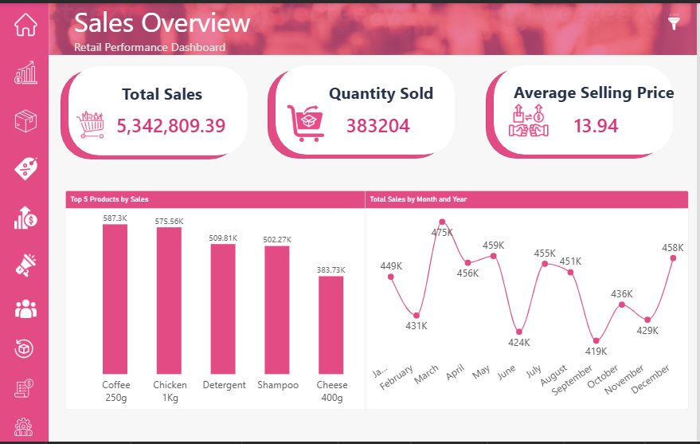

**الصورة 2 | Screenshot 02**

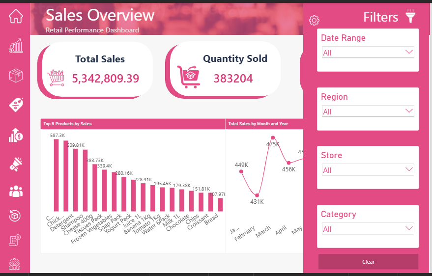

**الصورة 3 | Screenshot 03**

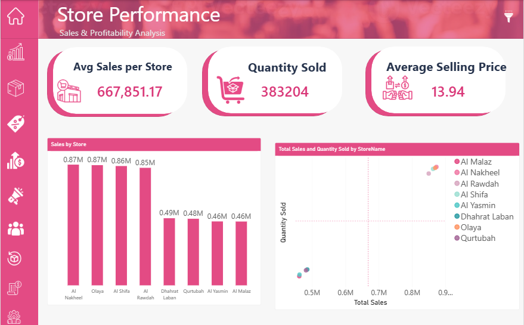

**الصورة 4 | Screenshot 04**

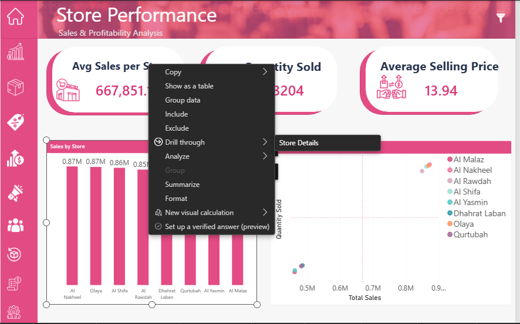

**الصورة 5 | Screenshot 05**

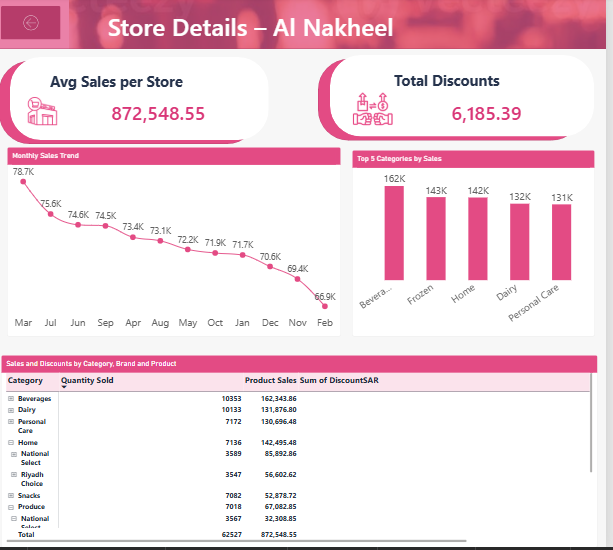

**الصورة 6 | Screenshot 06**

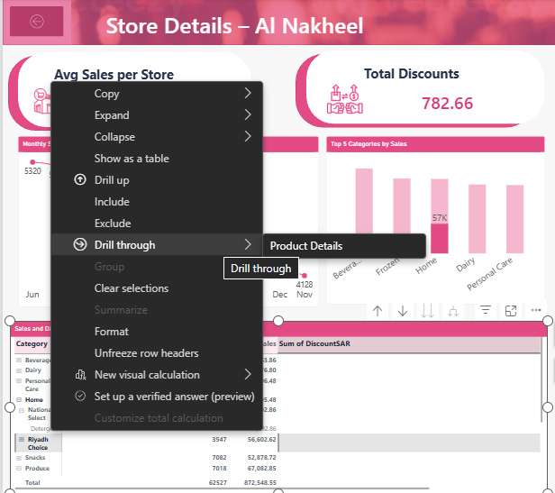

**الصورة 7 | Screenshot 07**

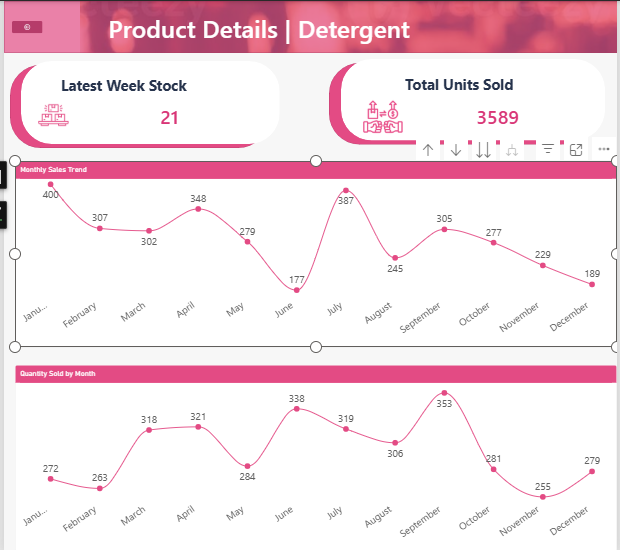

**الصورة 8 | Screenshot 08**

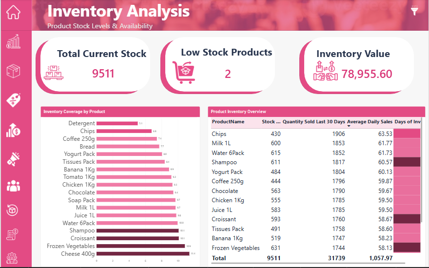

**الصورة 9 | Screenshot 09**

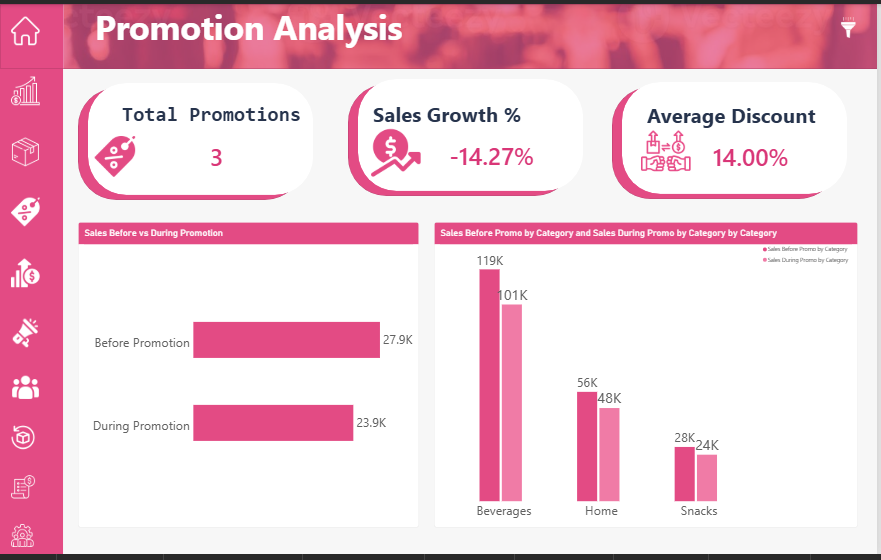

**الصورة 10 | Screenshot 10**

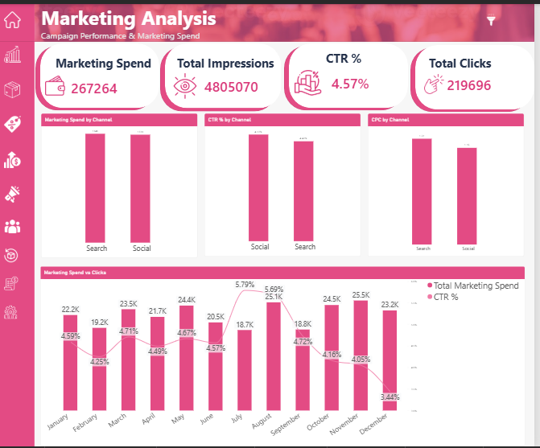

**الصورة 11 | Screenshot 11**

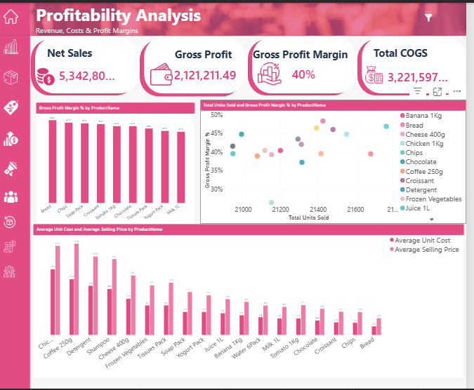

**الصورة 12 | Screenshot 12**

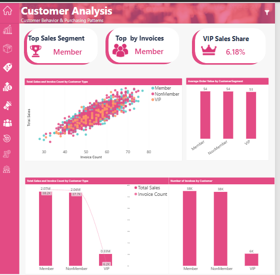

**الصورة 13 | Screenshot 13**

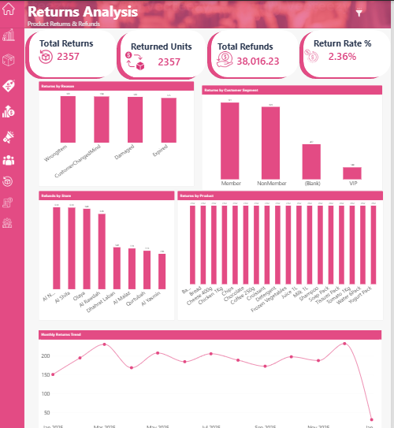

**الصورة 14 | Screenshot 14**

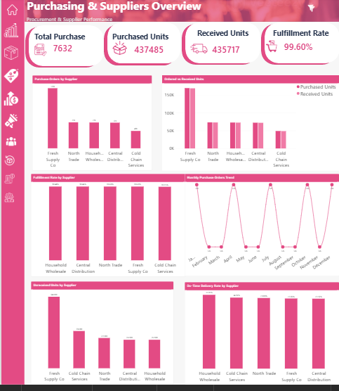

**الصورة 15 | Screenshot 15**

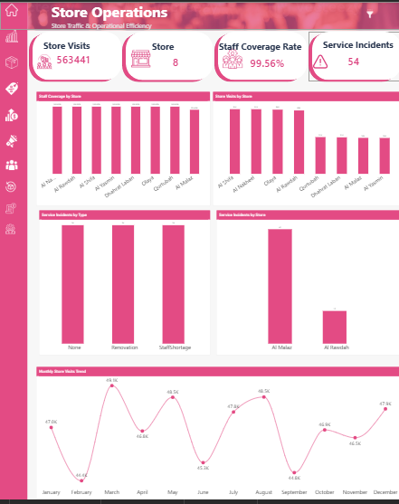

**الصورة 16 | Screenshot 16**

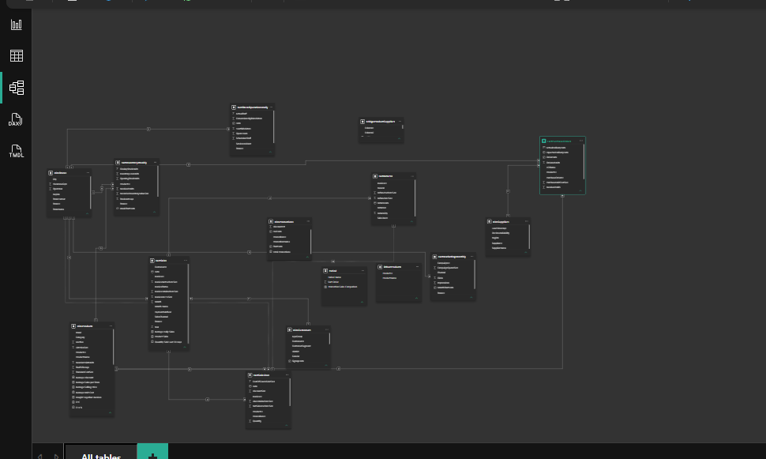

</details>

### ‏الصفحات المشمولة في التقرير

| ‏القسم | ‏ما الذي يحلله؟ |
|---|---|
| Sales Overview | ‏اتجاه المبيعات وأفضل المنتجات |
| Store Performance | ‏الفروقات بين الفروع |
| Profitability Analysis | ‏الأرباح وهوامش الربح والتكاليف |
| Inventory Analysis | ‏حالة المخزون والتغطية |
| Customer Analysis | ‏الشرائح وسلوك الفواتير |
| Returns Analysis | ‏المرتجعات ومبالغ الاسترداد |
| Purchasing & Suppliers | ‏الطلبيات والموردون والاستلام |
| Store Operations | ‏الزيارات والتغطية والحوادث |

<p dir="rtl" align="right">ملاحظة: رابط صور 1–15 يعتمد على مجلد `salses` كما ظهر في رابط GitHub، والصورة `16.png` ظهرت في جذر المستودع في اللقطة السابقة. إن تغيّر موقع صورة، ينبغي تعديل الرابط حسب مسارها الفعلي. إذا تبي ترتيب الصور حسب الصفحات لاحقًا، نطابق الرقم مع اسم الصفحة أولًا ثم نعدّل العناوين دون تغيير أسماء الملفات.</p>

## ‏💡 أبرز الرؤى | Key Insights

‏**1. أداء العملاء يحتاج قراءة أكثر من مؤشر واحد.** أظهرت مقارنة شرائح العملاء تقاربًا في متوسط قيمة الفاتورة، بينما تختلف المبيعات الإجمالية وعدد الفواتير؛ لذلك يُفضّل تفسير مساهمة كل شريحة باستخدام **عدد الفواتير ومتوسط قيمتها معًا**.

‏**2. الحجم لا يساوي الربحية.** تحليل المبيعات دون تكلفة المنتج أو هامش الربح قد يؤدي إلى ترتيب منتجات لا يعكس قيمتها الربحية.

‏**3. نسبة الاستلام المرتفعة لا تلغي الحاجة للمقارنة.** تظهر نسب **Fulfillment Rate** متقاربة بين الموردين، مع فروقات صغيرة تستحق المتابعة إلى جانب حجم الطلبات وتواريخ التسليم.

‏**4. مؤشرات التشغيل توفر سياقًا للأداء.** تساعد مقارنة زيارات الفروع وتغطية الموظفين والحوادث التشغيلية على تحديد أيام وفروع تستحق التحقيق، دون افتراض وجود علاقة سببية مباشرة.

## ‏✅ توصيات قابلة للدراسة | Business Recommendations

‏- مقارنة المنتجات الأعلى مبيعًا بالربح الإجمالي والهامش قبل اتخاذ قرارات الترويج أو التسعير.
‏- متابعة المنتجات منخفضة تغطية المخزون مع مراعاة الطلب عليها.
‏- تحليل الشرائح وفق **الإنفاق وتكرار الشراء** بدل إجمالي المبيعات وحده.
‏- تقييم الموردين حسب **الكمية المطلوبة والمستلمة والالتزام بالتسليم** معًا.
‏- مراجعة تكرار الحوادث التشغيلية حسب الفرع والزمن قبل اقتراح تدخلات تشغيلية.

‏> **تفسير مهني:** هذه توصيات للتحقق واتخاذ القرار، وليست إثباتًا لتحسن تم تنفيذه أو لسببية بين المؤشرات.

## ‏🛠️ الأدوات والمهارات | Tech Stack

|‏ المهارة |‏ التطبيق في المشروع |
|---|---|
| **Power BI** |‏ تقارير ولوحات تحليلية تفاعلية |
| **Power Query** |‏ تجهيز البيانات ومراجعة أنواعها |
| **Data Modeling** |‏ ربط جداول Fact وDimension |
| **DAX** |‏ مقاييس KPIs، نسب، متوسطات، تصفية سياق الحساب |
| **Data Visualization** |‏ اختيار الرسوم وتقليل ازدحامها واستخدام Top N |
| **Drillthrough / Bookmarks / Slicers** |‏ تحسين استكشاف البيانات والتنقل داخل التقرير |
| **Business Analysis** |‏ صياغة أسئلة أعمال وتفسير النتائج وتوصيات قابلة للدراسة |

## ‏🧮 جميع المقاييس: DAX + الحساب الرياضي + Practice

‏> يحتوي القسم التالي على الصيغ التي ناقشناها وأمثلة تعليمية؛ عند وجود عبارة «صيغة مرجعية مقترحة»، فهي ليست مقياسًا مثبتًا داخل ملف PBIX، ويلزم التحقق قبل نسبتها للتنفيذ.

## ‏طريقة قراءة المعادلات

‏- `SUM` = مجموع قيم عمود. `DISTINCTCOUNT` = عدد القيم المختلفة. `COUNTROWS` = عدد الصفوف.
‏- `DIVIDE(a,b,0)` = a ÷ b مع صفر عند انعدام المقام. `CALCULATE` = تعديل سياق الفلاتر.
‏- `SUMX` = ضرب/حساب لكل صف ثم جمع النواتج. `MAXX` = أكبر قيمة محسوبة خلال جدول.
‏- `VAR` يحفظ نتيجة مؤقتة داخل المقياس، و`RETURN` يحدد ما يعاد.


## المبيعات | Sales

### إجمالي المبيعات | Total Sales
‏**المعنى:** إجمالي صافي مبيعات الفواتير المكتملة.
‏**الطريقة الرياضية:** مجموع صافي قيمة الفواتير المكتملة قبل الضريبة.
‏**حالة التوثيق:** مناقَش سابقًا بصيغة موثقة.

**DAX**
```dax
Total Sales =
CALCULATE(
    SUM(FactSales[InvoiceNetExclVATSAR]),
    FactSales[InvoiceStatus] = "Completed"
)
```

‏**Practice — تمرين تطبيقي:** قارن مجموع 3 فواتير Completed مع بطاقة المبيعات، ولا تشمل الفواتير الملغاة.

‏**اختبار صحة النتيجة:** ضعي المقياس مع البعد المناسب في Table visual، قارني الإجمالي بمثال يدوي، ثم اختبري اختيار فرع/فترة زمنية.

### عدد الفواتير | Invoice Count
‏**المعنى:** عدد الفواتير المختلفة.
‏**الطريقة الرياضية:** عدد أرقام InvoiceID الفريدة.
‏**حالة التوثيق:** مناقَش سابقًا بصيغة موثقة.

**DAX**
```dax
Invoice Count =
DISTINCTCOUNT(FactSales[InvoiceID])
```

‏**Practice — تمرين تطبيقي:** تأكد أن الفاتورة المكررة بسبب سطور منتجات لا تُعد مرتين.

‏**اختبار صحة النتيجة:** ضعي المقياس مع البعد المناسب في Table visual، قارني الإجمالي بمثال يدوي، ثم اختبري اختيار فرع/فترة زمنية.

### عدد الفواتير المكتملة | Completed Invoice Count
‏**المعنى:** عدد الفواتير المكتملة.
‏**الطريقة الرياضية:** عدد الفواتير الفريدة حيث Status = Completed.
‏**حالة التوثيق:** صيغة مرجعية مقترحة.

**DAX**
```dax
Completed Invoice Count =
CALCULATE(
    DISTINCTCOUNT(FactSales[InvoiceID]),
    FactSales[InvoiceStatus] = "Completed"
)
```

‏**Practice — تمرين تطبيقي:** قارن Invoice Count مع Completed Invoice Count عند وجود حالات غير مكتملة.

‏**اختبار صحة النتيجة:** ضعي المقياس مع البعد المناسب في Table visual، قارني الإجمالي بمثال يدوي، ثم اختبري اختيار فرع/فترة زمنية.

### متوسط قيمة الفاتورة | Average Order Value
‏**المعنى:** متوسط قيمة الفاتورة.
‏**الطريقة الرياضية:** صافي مبيعات مكتملة ÷ عدد الفواتير المكتملة.
‏**حالة التوثيق:** صيغة منقّحة؛ في الدروس استخدمنا Invoice Count.

**DAX**
```dax
Average Order Value =
DIVIDE([Total Sales], [Completed Invoice Count], 0)
```

‏**Practice — تمرين تطبيقي:** إذا كانت المبيعات 500 وعدد الفواتير المكتملة 10 فالمتوسط 50.

‏**اختبار صحة النتيجة:** ضعي المقياس مع البعد المناسب في Table visual، قارني الإجمالي بمثال يدوي، ثم اختبري اختيار فرع/فترة زمنية.

### الكمية المباعة | Units Sold
‏**المعنى:** عدد الوحدات المباعة.
‏**الطريقة الرياضية:** مجموع Quantity من سطور الفواتير؛ يحتاج سياسة للملغاة.
‏**حالة التوثيق:** صيغة مرجعية مقترحة.

**DAX**
```dax
Units Sold =
SUM(FactSaleLines[Quantity])
```

‏**Practice — تمرين تطبيقي:** اختبر عدم احتساب الوحدات الملغاة إن وجدت.

‏**اختبار صحة النتيجة:** ضعي المقياس مع البعد المناسب في Table visual، قارني الإجمالي بمثال يدوي، ثم اختبري اختيار فرع/فترة زمنية.

## الربحية | Profitability

### إجمالي تكلفة البضاعة المباعة | Total COGS
‏**المعنى:** تكلفة البضاعة المباعة.
‏**الطريقة الرياضية:** مجموع CostOfGoodsSoldSAR.
‏**حالة التوثيق:** صيغة مرجعية مقترحة.

**DAX**
```dax
Total COGS =
SUM(FactSaleLines[CostOfGoodsSoldSAR])
```

‏**Practice — تمرين تطبيقي:** إذا كانت 3 قطع بتكلفة 5 فالنتيجة 15.

‏**اختبار صحة النتيجة:** ضعي المقياس مع البعد المناسب في Table visual، قارني الإجمالي بمثال يدوي، ثم اختبري اختيار فرع/فترة زمنية.

### الربح الإجمالي | Gross Profit
‏**المعنى:** الربح الإجمالي.
‏**الطريقة الرياضية:** صافي المبيعات − تكلفة البضاعة.
‏**حالة التوثيق:** صيغة مرجعية تحتاج التحقق من نطاق الفلاتر.

**DAX**
```dax
Gross Profit =
[Total Sales] - [Total COGS]
```

‏**Practice — تمرين تطبيقي:** مثال 1000 مبيعات و650 تكلفة = 350 ربح إجمالي.

‏**اختبار صحة النتيجة:** ضعي المقياس مع البعد المناسب في Table visual، قارني الإجمالي بمثال يدوي، ثم اختبري اختيار فرع/فترة زمنية.

### هامش الربح الإجمالي | Gross Margin %
‏**المعنى:** هامش الربح الإجمالي.
‏**الطريقة الرياضية:** الربح الإجمالي ÷ صافي المبيعات × 100%.
‏**حالة التوثيق:** صيغة مرجعية مقترحة.

**DAX**
```dax
Gross Margin % =
DIVIDE([Gross Profit], [Total Sales], 0)
```

‏**Practice — تمرين تطبيقي:** 350 ÷ 1000 = 35%؛ نسّقي Percentage.

‏**اختبار صحة النتيجة:** ضعي المقياس مع البعد المناسب في Table visual، قارني الإجمالي بمثال يدوي، ثم اختبري اختيار فرع/فترة زمنية.

## العملاء | Customers

### الفئة الأعلى مبيعات | Top Customer Segment by Sales
‏**المعنى:** الفئة الأعلى مبيعات.
‏**الطريقة الرياضية:** أعلى قيمة Sales بين الشرائح المحددة.
‏**حالة التوثيق:** مناقَش سابقًا بصيغة موثقة.

**DAX**
```dax
Top Customer Segment by Sales =
VAR T = ADDCOLUMNS(ALLSELECTED(DimCustomers[CustomerSegment]), "@Sales", [Total Sales])
VAR M = MAXX(T, [@Sales])
RETURN CONCATENATEX(FILTER(T, [@Sales] = M && NOT ISBLANK([@Sales])), DimCustomers[CustomerSegment], ", ")
```

‏**Practice — تمرين تطبيقي:** اختاري فئة واحدة في slicer وشوفي تغير البطاقة.

‏**اختبار صحة النتيجة:** ضعي المقياس مع البعد المناسب في Table visual، قارني الإجمالي بمثال يدوي، ثم اختبري اختيار فرع/فترة زمنية.

### الفئة الأعلى في عدد الفواتير | Top Segment by Invoices
‏**المعنى:** الفئة الأعلى عدد فواتير.
‏**الطريقة الرياضية:** أعلى قيمة Invoice Count بين الشرائح.
‏**حالة التوثيق:** مناقَش سابقًا بصيغة موثقة.

**DAX**
```dax
Top Segment by Invoices =
VAR T = ADDCOLUMNS(ALLSELECTED(DimCustomers[CustomerSegment]), "@Invoices", [Invoice Count])
VAR M = MAXX(T, [@Invoices])
RETURN CONCATENATEX(FILTER(T, [@Invoices] = M && NOT ISBLANK([@Invoices])), DimCustomers[CustomerSegment], ", ")
```

‏**Practice — تمرين تطبيقي:** راجعي الفئة الأعلى في جدول مقارنة Invoice Count.

‏**اختبار صحة النتيجة:** ضعي المقياس مع البعد المناسب في Table visual، قارني الإجمالي بمثال يدوي، ثم اختبري اختيار فرع/فترة زمنية.

### حصة مبيعات كبار العملاء | VIP Sales Share
‏**المعنى:** حصة VIP من المبيعات.
‏**الطريقة الرياضية:** مبيعات VIP ÷ مبيعات جميع الشرائح، وقد يشمل المقام GUEST.
‏**حالة التوثيق:** مناقَش سابقًا؛ تحذير متعلق بالمقام.

**DAX**
```dax
VIP Sales Share =
VAR VIPSales = CALCULATE([Total Sales], REMOVEFILTERS(DimCustomers[CustomerSegment]), DimCustomers[CustomerSegment] = "VIP")
VAR AllSales = CALCULATE([Total Sales], REMOVEFILTERS(DimCustomers[CustomerSegment]))
RETURN DIVIDE(VIPSales, AllSales, 0)
```

‏**Practice — تمرين تطبيقي:** اختبري إذا يشمل المقام فواتير الضيوف وحددي التسمية وفق ذلك.

‏**اختبار صحة النتيجة:** ضعي المقياس مع البعد المناسب في Table visual، قارني الإجمالي بمثال يدوي، ثم اختبري اختيار فرع/فترة زمنية.

## المرتجعات | Returns

### عدد المرتجعات | Total Returns
‏**المعنى:** عدد عمليات الإرجاع.
‏**الطريقة الرياضية:** عدد ReturnID غير المكرر.
‏**حالة التوثيق:** مناقَش سابقًا.

**DAX**
```dax
Total Returns =
DISTINCTCOUNT(FactReturns[ReturnID])
```

‏**Practice — تمرين تطبيقي:** قارني القيمة بعدد صفوف المرتجعات (قد تختلف لو تكررت IDs).

‏**اختبار صحة النتيجة:** ضعي المقياس مع البعد المناسب في Table visual، قارني الإجمالي بمثال يدوي، ثم اختبري اختيار فرع/فترة زمنية.

### الوحدات المرتجعة | Returned Units
‏**المعنى:** عدد القطع المرتجعة.
‏**الطريقة الرياضية:** مجموع ReturnQty.
‏**حالة التوثيق:** مناقَش سابقًا.

**DAX**
```dax
Returned Units =
SUM(FactReturns[ReturnQty])
```

‏**Practice — تمرين تطبيقي:** مثال إرجاع 2+3=5 وحدات.

‏**اختبار صحة النتيجة:** ضعي المقياس مع البعد المناسب في Table visual، قارني الإجمالي بمثال يدوي، ثم اختبري اختيار فرع/فترة زمنية.

### إجمالي المبالغ المستردة | Total Refunds
‏**المعنى:** مبالغ الاسترداد شاملة الضريبة.
‏**الطريقة الرياضية:** الاسترداد قبل الضريبة + VAT.
‏**حالة التوثيق:** مناقَش سابقًا.

**DAX**
```dax
Total Refunds =
SUM(FactReturns[RefundExclVATSAR]) + SUM(FactReturns[RefundVATSAR])
```

‏**Practice — تمرين تطبيقي:** قارني مثالا 100+15=115.

‏**اختبار صحة النتيجة:** ضعي المقياس مع البعد المناسب في Table visual، قارني الإجمالي بمثال يدوي، ثم اختبري اختيار فرع/فترة زمنية.

### الفواتير التي تتضمن مرتجعًا | Returned Invoices
‏**المعنى:** الفواتير التي بها مرتجع.
‏**الطريقة الرياضية:** Distinct InvoiceID من FactReturns.
‏**حالة التوثيق:** مناقَش سابقًا.

**DAX**
```dax
Returned Invoices =
DISTINCTCOUNT(FactReturns[InvoiceID])
```

‏**Practice — تمرين تطبيقي:** الفاتورة ذات مرتجعين تُعد مرة واحدة.

‏**اختبار صحة النتيجة:** ضعي المقياس مع البعد المناسب في Table visual، قارني الإجمالي بمثال يدوي، ثم اختبري اختيار فرع/فترة زمنية.

### نسبة الفواتير التي تتضمن مرتجعًا | Invoice Return Rate %
‏**المعنى:** نسبة الفواتير ذات مرتجع.
‏**الطريقة الرياضية:** فواتير ذات مرتجع ÷ جميع الفواتير المتوافقة زمنيًا.
‏**حالة التوثيق:** صيغة استخدمناها كخطوة تعليمية؛ تحتاج توحيد الفترة.

**DAX**
```dax
Invoice Return Rate % =
DIVIDE([Returned Invoices], [Invoice Count], 0)
```

‏**Practice — تمرين تطبيقي:** احذري ReturnDate مقابل Sales Date عند فلاتر الشهور.

‏**اختبار صحة النتيجة:** ضعي المقياس مع البعد المناسب في Table visual، قارني الإجمالي بمثال يدوي، ثم اختبري اختيار فرع/فترة زمنية.

## المشتريات والموردون | Purchasing

### عدد أوامر الشراء | Total Purchase Orders
‏**المعنى:** عدد أوامر الشراء.
‏**الطريقة الرياضية:** DISTINCTCOUNT PurchaseOrderID.
‏**حالة التوثيق:** مناقَش سابقًا.

**DAX**
```dax
Total Purchase Orders =
DISTINCTCOUNT(FactPurchaseOrders[PurchaseOrderID])
```

‏**Practice — تمرين تطبيقي:** تأكدي أن تكرار الصفوف لا يضخم عدد الطلبات.

‏**اختبار صحة النتيجة:** ضعي المقياس مع البعد المناسب في Table visual، قارني الإجمالي بمثال يدوي، ثم اختبري اختيار فرع/فترة زمنية.

### الوحدات المطلوبة | Purchased Units
‏**المعنى:** الوحدات المطلوبة.
‏**الطريقة الرياضية:** مجموع OrderedUnits.
‏**حالة التوثيق:** مناقَش سابقًا؛ الاسم الفعلي للعمود OrderedUnits.

**DAX**
```dax
Purchased Units =
SUM(FactPurchaseOrders[OrderedUnits])
```

‏**Practice — تمرين تطبيقي:** مثال طلب 100 واستلام 80: المطلوبة 100.

‏**اختبار صحة النتيجة:** ضعي المقياس مع البعد المناسب في Table visual، قارني الإجمالي بمثال يدوي، ثم اختبري اختيار فرع/فترة زمنية.

### الوحدات المستلمة | Received Units
‏**المعنى:** الوحدات المستلمة.
‏**الطريقة الرياضية:** مجموع ReceivedUnits.
‏**حالة التوثيق:** صيغة مرجعية على أعمدة الملف.

**DAX**
```dax
Received Units =
SUM(FactPurchaseOrders[ReceivedUnits])
```

‏**Practice — تمرين تطبيقي:** مثال طلب 100 واستلام 80: المستلمة 80.

‏**اختبار صحة النتيجة:** ضعي المقياس مع البعد المناسب في Table visual، قارني الإجمالي بمثال يدوي، ثم اختبري اختيار فرع/فترة زمنية.

### الوحدات غير المستلمة | Unreceived Units
‏**المعنى:** فرق الوحدات غير المستلمة.
‏**الطريقة الرياضية:** الوحدات المطلوبة − المستلمة.
‏**حالة التوثيق:** مناقَش سابقًا بمفهوم الطرح.

**DAX**
```dax
Unreceived Units =
[Purchased Units] - [Received Units]
```

‏**Practice — تمرين تطبيقي:** 100 − 80 = 20.

‏**اختبار صحة النتيجة:** ضعي المقياس مع البعد المناسب في Table visual، قارني الإجمالي بمثال يدوي، ثم اختبري اختيار فرع/فترة زمنية.

### معدل تنفيذ الطلبات | Fulfillment Rate
‏**المعنى:** نسبة تلبية الكمية المطلوبة.
‏**الطريقة الرياضية:** الوحدات المستلمة ÷ المطلوبة.
‏**حالة التوثيق:** صيغة مرجعية على بيانات الملف.

**DAX**
```dax
Fulfillment Rate =
DIVIDE([Received Units], [Purchased Units], 0)
```

‏**Practice — تمرين تطبيقي:** 80 ÷ 100 = 80%.

‏**اختبار صحة النتيجة:** ضعي المقياس مع البعد المناسب في Table visual، قارني الإجمالي بمثال يدوي، ثم اختبري اختيار فرع/فترة زمنية.

### قيمة أوامر الشراء | Purchase Order Value
‏**المعنى:** قيمة أوامر الشراء.
‏**الطريقة الرياضية:** مجموع (الكمية المطلوبة × تكلفة الوحدة).
‏**حالة التوثيق:** صيغة مرجعية مقترحة.

**DAX**
```dax
Purchase Order Value =
SUMX(
    FactPurchaseOrders,
    FactPurchaseOrders[OrderedUnits] * FactPurchaseOrders[PurchaseUnitCostSAR]
)
```

‏**Practice — تمرين تطبيقي:** 10 × 20 + 5 × 30 = 350.

‏**اختبار صحة النتيجة:** ضعي المقياس مع البعد المناسب في Table visual، قارني الإجمالي بمثال يدوي، ثم اختبري اختيار فرع/فترة زمنية.

### نسبة التسليم في الموعد | On-Time Delivery Rate
‏**المعنى:** نسبة التسليم في الوقت.
‏**الطريقة الرياضية:** عدد أوامر الاستلام الفريدة بموعد فعلي <= المتوقع ÷ جميع الأوامر ذات تاريخي تسليم.
‏**حالة التوثيق:** صيغة مرجعية مشروطة: عند تكرار PurchaseOrderID بتاريخين متعارضين تحتاج سياسة حسم على مستوى الأمر.

**DAX**
```dax
On-Time Delivery Rate =
VAR DeliveredOrders =
    FILTER(
        FactPurchaseOrders,
        NOT ISBLANK(FactPurchaseOrders[ActualDeliveryDate]) &&
        NOT ISBLANK(FactPurchaseOrders[ExpectedDeliveryDate])
    )
VAR OnTimeOrders =
    FILTER(
        DeliveredOrders,
        FactPurchaseOrders[ActualDeliveryDate] <= FactPurchaseOrders[ExpectedDeliveryDate]
    )
RETURN
    DIVIDE(
        COUNTROWS(SUMMARIZE(OnTimeOrders, FactPurchaseOrders[PurchaseOrderID])),
        COUNTROWS(SUMMARIZE(DeliveredOrders, FactPurchaseOrders[PurchaseOrderID])),
        0
    )
```

‏**Practice — تمرين تطبيقي:** احسبي 8 طلبات في الموعد من 10 طلبات مستلمة = 80%.

‏**اختبار صحة النتيجة:** ضعي المقياس مع البعد المناسب في Table visual، قارني الإجمالي بمثال يدوي، ثم اختبري اختيار فرع/فترة زمنية.

## عمليات المتاجر | Operations

### إجمالي زيارات المتاجر | Total Store Visits
‏**المعنى:** زيارات المتاجر.
‏**الطريقة الرياضية:** مجموع FootfallVisitors.
‏**حالة التوثيق:** مناقَش سابقًا.

**DAX**
```dax
Total Store Visits =
SUM(FactStoreOperationsDaily[FootfallVisitors])
```

‏**Practice — تمرين تطبيقي:** تحقق مرجعي 563441.

‏**اختبار صحة النتيجة:** ضعي المقياس مع البعد المناسب في Table visual، قارني الإجمالي بمثال يدوي، ثم اختبري اختيار فرع/فترة زمنية.

### عدد المتاجر | Total Stores
‏**المعنى:** عدد الفروع.
‏**الطريقة الرياضية:** عدد StoreID الفريد.
‏**حالة التوثيق:** مناقَش سابقًا.

**DAX**
```dax
Total Stores =
DISTINCTCOUNT(DimStores[StoreID])
```

‏**Practice — تمرين تطبيقي:** تحقق مرجعي 8.

‏**اختبار صحة النتيجة:** ضعي المقياس مع البعد المناسب في Table visual، قارني الإجمالي بمثال يدوي، ثم اختبري اختيار فرع/فترة زمنية.

### نسبة تغطية الموظفين | Staff Coverage Rate
‏**المعنى:** نسبة تغطية الموظفين.
‏**الطريقة الرياضية:** مجموع العاملين فعليًا ÷ المجدولين.
‏**حالة التوثيق:** مناقَش سابقًا.

**DAX**
```dax
Staff Coverage Rate =
DIVIDE(SUM(FactStoreOperationsDaily[ActualStaff]), SUM(FactStoreOperationsDaily[ScheduledStaff]), 0)
```

‏**Practice — تمرين تطبيقي:** تحقق مرجعي ~99.56%.

‏**اختبار صحة النتيجة:** ضعي المقياس مع البعد المناسب في Table visual، قارني الإجمالي بمثال يدوي، ثم اختبري اختيار فرع/فترة زمنية.

### عدد الحوادث التشغيلية | Total Service Incidents
‏**المعنى:** عدد الحوادث التشغيلية.
‏**الطريقة الرياضية:** عد الصفوف ذات حادثة غير None.
‏**حالة التوثيق:** مناقَش سابقًا.

**DAX**
```dax
Total Service Incidents =
CALCULATE(
    COUNTROWS(FactStoreOperationsDaily),
    FactStoreOperationsDaily[ServiceIncident] <> "None",
    NOT ISBLANK(FactStoreOperationsDaily[ServiceIncident])
)
```

‏**Practice — تمرين تطبيقي:** تحقق مرجعي 54.

‏**اختبار صحة النتيجة:** ضعي المقياس مع البعد المناسب في Table visual، قارني الإجمالي بمثال يدوي، ثم اختبري اختيار فرع/فترة زمنية.

## التسويق | Marketing

### الإنفاق التسويقي | Marketing Spend
‏**المعنى:** إنفاق التسويق.
‏**الطريقة الرياضية:** مجموع الإنفاق.
‏**حالة التوثيق:** صيغة مرجعية مقترحة.

**DAX**
```dax
Marketing Spend =
SUM(FactMarketingMonthly[CampaignSpendSAR])
```

‏**Practice — تمرين تطبيقي:** جمع نفقات الحملات لشهر واحد ثم قارني الإجمالي.

‏**اختبار صحة النتيجة:** ضعي المقياس مع البعد المناسب في Table visual، قارني الإجمالي بمثال يدوي، ثم اختبري اختيار فرع/فترة زمنية.

### معدل النقر إلى الظهور | CTR %
‏**المعنى:** نسبة النقر إلى الظهور.
‏**الطريقة الرياضية:** النقرات ÷ مرات الظهور.
‏**حالة التوثيق:** صيغة مرجعية مقترحة.

**DAX**
```dax
CTR % =
DIVIDE(SUM(FactMarketingMonthly[Clicks]), SUM(FactMarketingMonthly[Impressions]), 0)
```

‏**Practice — تمرين تطبيقي:** 500 نقرة / 10000 ظهور = 5%.

‏**اختبار صحة النتيجة:** ضعي المقياس مع البعد المناسب في Table visual، قارني الإجمالي بمثال يدوي، ثم اختبري اختيار فرع/فترة زمنية.

### تكلفة النقرة | CPC
‏**المعنى:** التكلفة لكل نقرة.
‏**الطريقة الرياضية:** الإنفاق ÷ النقرات.
‏**حالة التوثيق:** صيغة مرجعية مقترحة.

**DAX**
```dax
CPC =
DIVIDE(SUM(FactMarketingMonthly[CampaignSpendSAR]), SUM(FactMarketingMonthly[Clicks]), 0)
```

‏**Practice — تمرين تطبيقي:** 100 ريال / 20 نقرة = 5 ريال.

‏**اختبار صحة النتيجة:** ضعي المقياس مع البعد المناسب في Table visual، قارني الإجمالي بمثال يدوي، ثم اختبري اختيار فرع/فترة زمنية.

## أهداف المبيعات | Targets

### هدف المبيعات | Sales Target
‏**المعنى:** هدف المبيعات.
‏**الطريقة الرياضية:** مجموع الأهداف بعد مواءمة سياق الفترة والفئة.
‏**حالة التوثيق:** صيغة مرجعية؛ راجعي العلاقات عند الفئات/الشهور.

**DAX**
```dax
Sales Target =
SUM(FactMonthlyTargets[NetSalesTargetSAR])
```

‏**Practice — تمرين تطبيقي:** إجمالي CSV السنوي = 3102720.

‏**اختبار صحة النتيجة:** ضعي المقياس مع البعد المناسب في Table visual، قارني الإجمالي بمثال يدوي، ثم اختبري اختيار فرع/فترة زمنية.

### نسبة تحقيق الهدف | Target Achievement %
‏**المعنى:** تحقيق هدف المبيعات.
‏**الطريقة الرياضية:** المبيعات الفعلية ÷ الهدف.
‏**حالة التوثيق:** صيغة مرجعية؛ لا تقارني فترات مختلفة.

**DAX**
```dax
Target Achievement % =
DIVIDE([Total Sales], [Sales Target], 0)
```

‏**Practice — تمرين تطبيقي:** 500 / 400 = 125%.

‏**اختبار صحة النتيجة:** ضعي المقياس مع البعد المناسب في Table visual، قارني الإجمالي بمثال يدوي، ثم اختبري اختيار فرع/فترة زمنية.

### الفرق بين المبيعات والهدف | Sales Target Variance
‏**المعنى:** فرق الهدف.
‏**الطريقة الرياضية:** المبيعات الفعلية − الهدف.
‏**حالة التوثيق:** صيغة مرجعية.

**DAX**
```dax
Sales Target Variance =
[Total Sales] - [Sales Target]
```

‏**Practice — تمرين تطبيقي:** 500 − 400 = +100.

‏**اختبار صحة النتيجة:** ضعي المقياس مع البعد المناسب في Table visual، قارني الإجمالي بمثال يدوي، ثم اختبري اختيار فرع/فترة زمنية.

## شكاوى العملاء | Complaints

### إجمالي الشكاوى | Total Complaints
‏**المعنى:** عدد الشكاوى.
‏**الطريقة الرياضية:** عدد TicketID المختلفة.
‏**حالة التوثيق:** صيغة مرجعية مقترحة.

**DAX**
```dax
Total Complaints =
DISTINCTCOUNT(FactCustomerComplaints[TicketID])
```

‏**Practice — تمرين تطبيقي:** تحقق مرجعي 1761.

‏**اختبار صحة النتيجة:** ضعي المقياس مع البعد المناسب في Table visual، قارني الإجمالي بمثال يدوي، ثم اختبري اختيار فرع/فترة زمنية.

### متوسط أيام معالجة الشكاوى | Average Resolution Days
‏**المعنى:** متوسط أيام الحل.
‏**الطريقة الرياضية:** متوسط ResolutionDays.
‏**حالة التوثيق:** صيغة مرجعية مقترحة.

**DAX**
```dax
Average Resolution Days =
AVERAGE(FactCustomerComplaints[ResolutionDays])
```

‏**Practice — تمرين تطبيقي:** 2, 4, 6 أيام => متوسط 4.

‏**اختبار صحة النتيجة:** ضعي المقياس مع البعد المناسب في Table visual، قارني الإجمالي بمثال يدوي، ثم اختبري اختيار فرع/فترة زمنية.

### الشكاوى عالية الخطورة | High Severity Complaints
‏**المعنى:** عدد الشكاوى عالية الخطورة.
‏**الطريقة الرياضية:** عدد التذاكر حيث Severity = High.
‏**حالة التوثيق:** صيغة مرجعية مقترحة.

**DAX**
```dax
High Severity Complaints =
CALCULATE(DISTINCTCOUNT(FactCustomerComplaints[TicketID]), FactCustomerComplaints[Severity] = "High")
```

‏**Practice — تمرين تطبيقي:** تحقق مرجعي 563.

‏**اختبار صحة النتيجة:** ضعي المقياس مع البعد المناسب في Table visual، قارني الإجمالي بمثال يدوي، ثم اختبري اختيار فرع/فترة زمنية.

## ‏أهم أخطاء DAX التي يجب تجنبها

‏1. لا تقسمي مبيعات Completed على عدد فواتير تشمل حالات أخرى إلا إذا كان هذا تعريف المؤشر المقصود.
‏2. لا تضربي إجمالي الكمية في إجمالي تكلفة الوحدة؛ `SUMX` يجري الضرب صفًا صفًا ثم يجمع.
‏3. لا تجمعي أرصدة ClosingStockUnits لكل الأسابيع بوصفها مخزون اليوم.
‏4. لا تنسبي نتائج GUEST لفئة Member أو VIP؛ GUEST بلا صف في DimCustomers.
‏5. انتبهي إلى فرق Refund Date وInvoice Date عند مقارنة المرتجعات بالمبيعات.
‏6. لا تستنتجي السببية من الرسوم الوصفية.
‏7. عند استخدام `ALLSELECTED` أو `REMOVEFILTERS` اختبري هل مقام النسبة يشمل العملاء الضيوف.

## ‏👩‍💻 عن صاحبة المشروع | About Me

**Hanan Aljaber**  
‏خريجة علوم حاسب، مهتمة بتحليل البيانات وذكاء الأعمال، وبناء حلول تساعد على تحويل البيانات إلى رؤى واضحة تدعم اتخاذ القرارات.

**Power BI · SQL · Python · Excel · DAX**

[GitHub Profile](https://github.com/HananAljaber)
